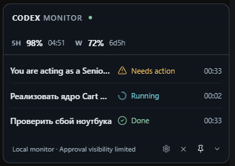
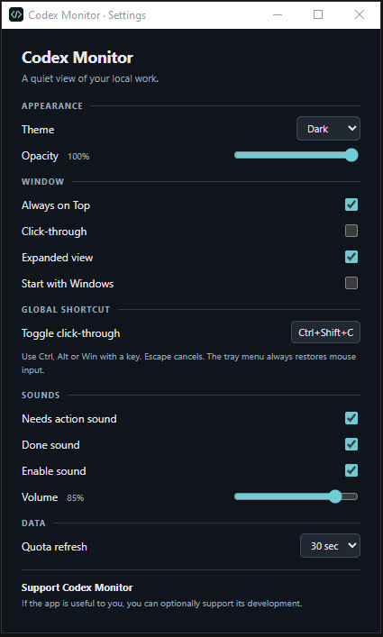

# Codex Monitor

Codex Monitor is a tiny always-on-top Windows monitor for local Codex work in VS Code.

**Status:** `v0.1.0-beta`

## Screenshots

**Collapsed**

**Expanded**

**Collapsed in use**

**Settings**

## What it shows

- Remaining 5-hour and weekly Codex quota, with reset countdowns.
- Task states: Running, Needs action, and Done.
- Elapsed task time in the expanded view.
- A compact collapsed view and a task-list expanded view.

## Why it exists

Codex can work for a while in the background. The widget lets you check quota and task state while another window is in front of VS Code.

## Features

- Compact translucent widget with an optional always-on-top setting.
- Collapsed and expanded modes; drag the widget to place it on screen.
- Click-through mode, a configurable global shortcut, and a system-tray fallback for restoring mouse input.
- Local quota monitoring and Running / Needs action / Done task states.
- Sound alerts for Needs action and Done, with per-event controls and volume. No desktop notification pop-ups.
- Dark, Light, and System themes; opacity control.
- System-tray controls and optional Start with Windows.
- An optional Support dialog in Settings.

## Installation

Requires Windows 10 or 11, VS Code, and the Codex extension installed and signed in for local use. When the public beta is published, download the Windows installer from GitHub Releases and run it. An unsigned build may trigger a Windows SmartScreen warning.

## Usage

Launch Codex Monitor, then use Codex in VS Code. The widget shows available quota and task states automatically. Open Settings from the expanded widget or system tray. By default, **Ctrl+Shift+C** toggles click-through; you can change the shortcut in Settings. The tray menu can restore mouse input if the widget cannot be clicked.

## Settings

Settings cover theme, opacity, always-on-top, click-through, global shortcut, sound alerts and volume, quota refresh interval, and Start with Windows.

## Support

If Codex Monitor is useful to you, you can optionally support its development from the Support section in Settings.

## Feedback

Tried Codex Monitor? I'd like to hear how it works for you. [Report a bug](../../issues/new?template=bug_report.yml) or [share feedback](../../issues/new?template=feedback.yml).

## Privacy

Codex Monitor is a local-only utility. It has no telemetry or remote backend of its own and does not upload prompts or responses. The Support dialog only displays a public receiving address; the app does not connect to a wallet, process payments, or use a private key or seed phrase.

## Known limitations

- This beta supports Windows and local Codex in VS Code only. macOS, the Codex desktop app, and PyCharm / other JetBrains IDEs are not supported yet.
- Needs action visibility depends on the local Codex / VS Code events available to an independent monitor. In particular, pending IDE approvals may not be visible.
- This is beta software. An unsigned installer may prompt Windows SmartScreen.

## License

[MIT](LICENSE).
